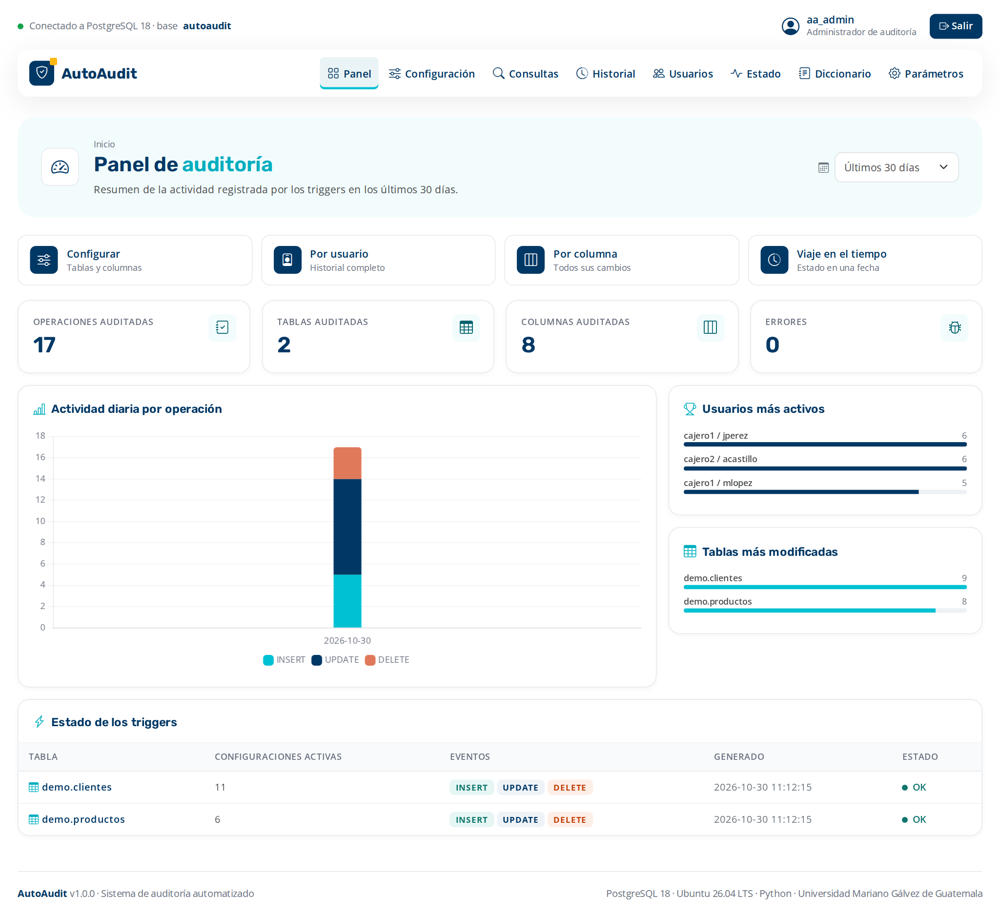
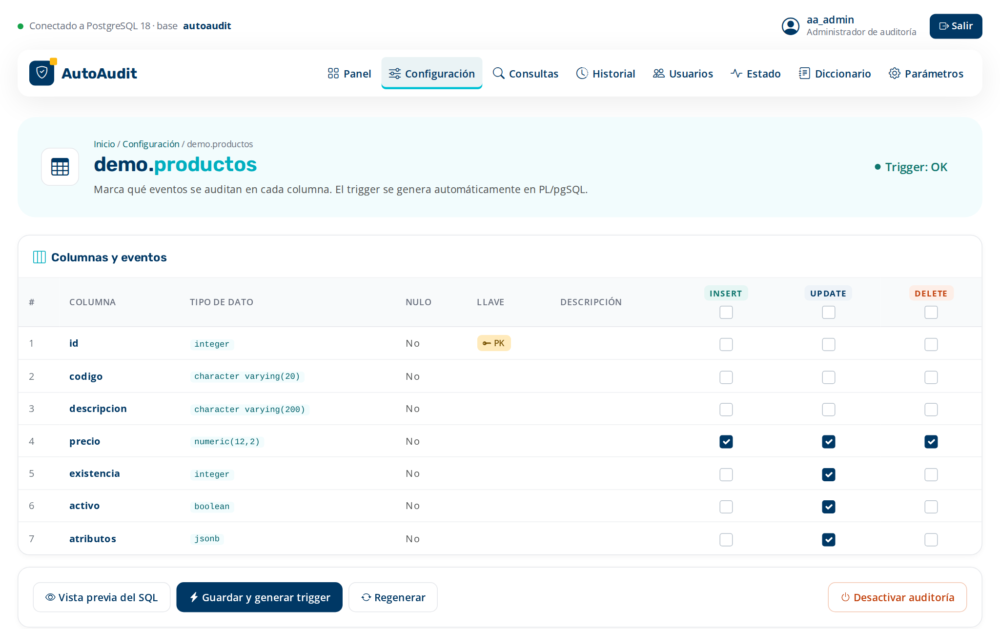
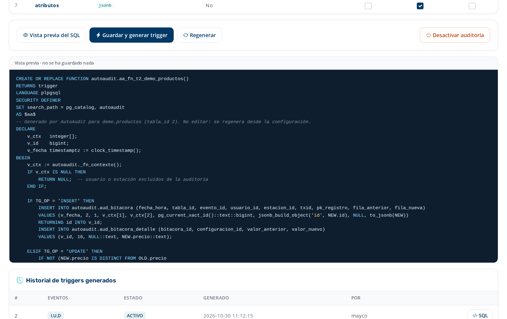
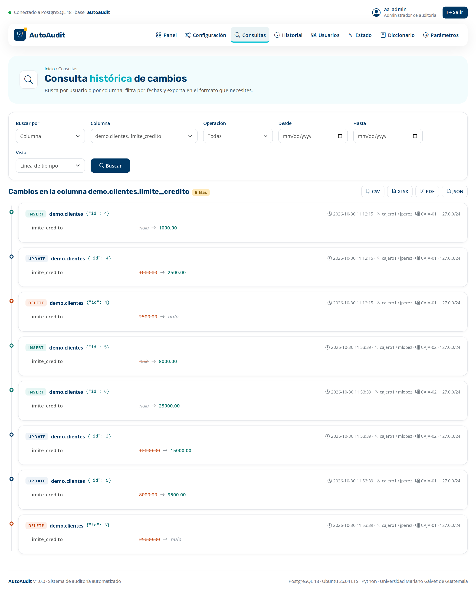
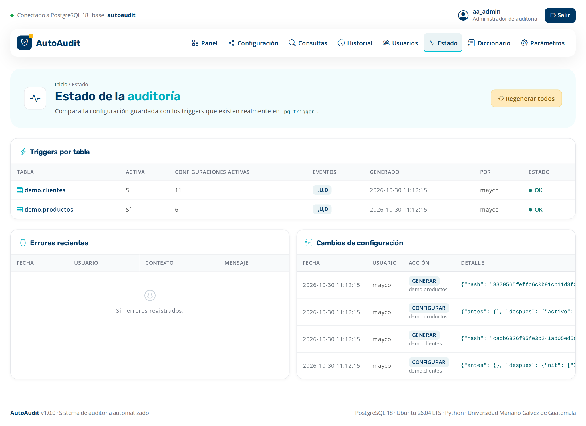
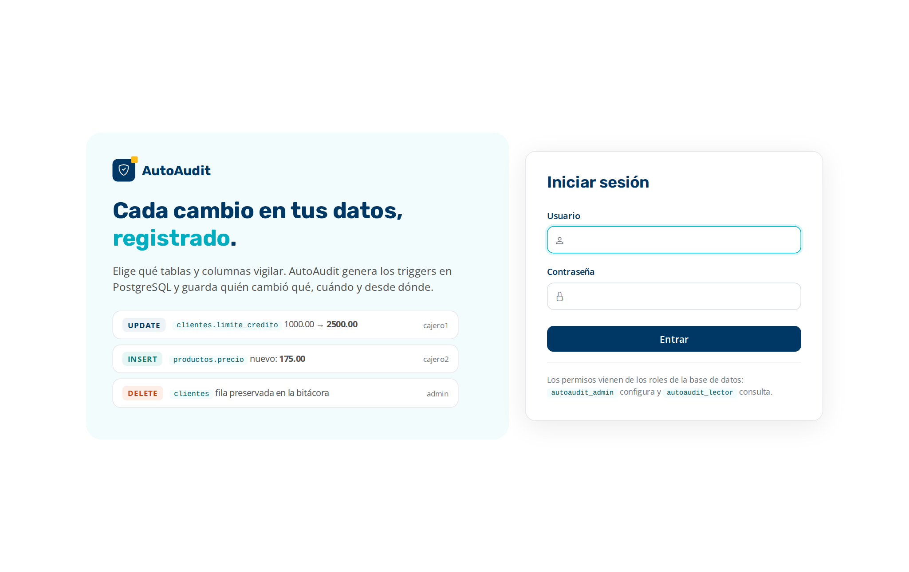
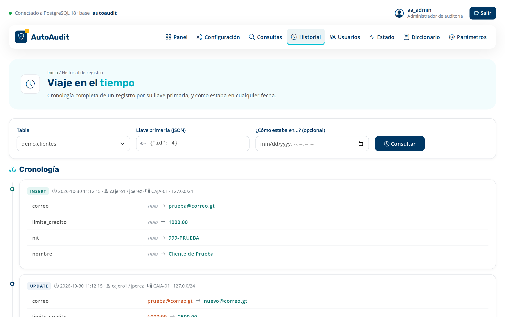
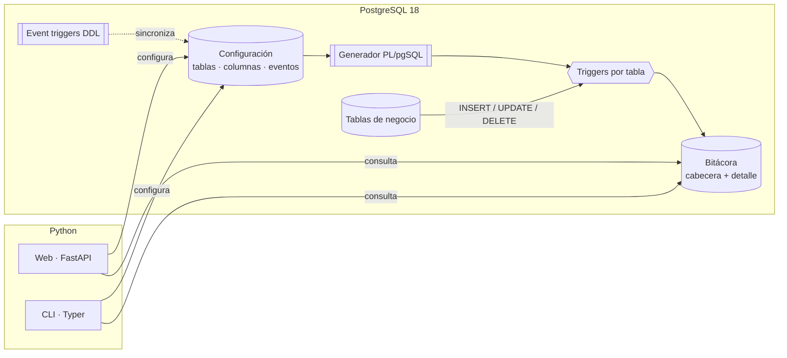
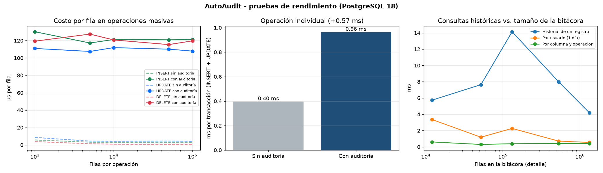

<div align="center">

# AutoAudit

**Sistema de auditoría automatizado para PostgreSQL**

Elige qué tablas y columnas vigilar. AutoAudit genera los triggers en PL/pgSQL y registra
quién cambió qué, cuándo, desde dónde, y cuál era el valor antes y después.

[](https://github.com/Gaston1x/autoaudit/actions/workflows/pruebas.yml)


[](LICENSE)

**[🌐 Ver demo en vivo](https://autoaudit-umg.mexicocentral.cloudapp.azure.com)** · [Documentación (PDF)](docs/AutoAudit_Documentacion.pdf) · [Instalación](#instalación) · [Uso](#uso) · [Pruebas](#pruebas-y-rendimiento)



</div>

---

## ¿Qué problema resuelve?

En una base de datos cualquier usuario con permisos puede modificar o borrar información, y después
no queda rastro de quién lo hizo ni de cuál era el valor original. AutoAudit agrega esa trazabilidad
**sin tocar las aplicaciones existentes**: la auditoría vive dentro de PostgreSQL, así que ningún cambio
escapa, venga de donde venga.

## Características

| | |
|---|---|
| 🗂️ **Configuración desde el diccionario de datos** | Solo se ofrecen tablas y columnas que existen (`pg_catalog`); se elige columna por columna qué operaciones auditar. |
| ⚡ **Triggers generados dinámicamente** | Una función PL/pgSQL y un trigger `AFTER … FOR EACH ROW` por tabla, con vista previa del SQL antes de aplicarlo. |
| 🧾 **Bitácora completa e inmutable** | Usuario, estación, IP, fecha y hora, valor anterior y nuevo, y la fila completa: los datos se conservan aunque el registro se borre. Ni el superusuario puede alterarla. |
| 🔗 **Se adapta a cambios de estructura** | Event triggers detectan `DROP TABLE`, `DROP COLUMN`, `RENAME` y triggers borrados o deshabilitados a mano. |
| 🔎 **Consultas y reportes** | Por usuario, por columna, historial de un registro y "viaje en el tiempo"; exportación a CSV, Excel, PDF y JSON. |
| 🔐 **Seguridad por roles** | Solo administradores configuran; lectores consultan con la IP enmascarada; política de privacidad configurable (completa, enmascarada o hash). |
| 🧪 **Probado** | 81 pruebas automáticas en cada cambio y pruebas de rendimiento con más de un millón de registros. |

## Capturas

<table>
  <tr>
    <td width="50%"><br><sub><b>Configuración</b>: columnas y eventos a auditar.</sub></td>
    <td width="50%"><br><sub><b>Vista previa</b> del trigger generado en PL/pgSQL.</sub></td>
  </tr>
  <tr>
    <td><br><sub><b>Línea de tiempo</b> de los cambios de una columna.</sub></td>
    <td><br><sub><b>Estado</b>: configuración contra triggers reales, errores y cambios.</sub></td>
  </tr>
  <tr>
    <td><br><sub><b>Acceso</b> con los usuarios y roles de PostgreSQL.</sub></td>
    <td><br><sub><b>Historial</b> de un registro y su estado en cualquier fecha.</sub></td>
  </tr>
</table>

## Arquitectura



Modelo entidad-relación completo: [`docs/img/er_autoaudit.svg`](docs/img/er_autoaudit.svg).

## Instalación

Requisitos: **Ubuntu 26.04 LTS** (o WSL2), **PostgreSQL 18** y **Python 3.12+**.

```bash
git clone https://github.com/Gaston1x/autoaudit.git
cd autoaudit
sudo bash scripts/install.sh       # PostgreSQL 18, base de datos, datos de ejemplo y entorno de Python
.venv/bin/uvicorn app.main:app --host 0.0.0.0 --port 8000
```

Abre <http://localhost:8000>. Usuarios de prueba (solo para el entorno local, ver [`.env.example`](.env.example)):

| Usuario | Contraseña | Rol |
|---|---|---|
| `aa_admin` | `AutoAudit.Admin1` | Administrador de auditoría |
| `aa_lector` | `AutoAudit.Lector1` | Lector |
| `cajero1`, `cajero2` | ver `.env.example` | Usuarios de negocio (sus cambios se auditan) |

Instalación manual y despliegue en un esquema propio: sección 7 de la [documentación](docs/AutoAudit_Documentacion.pdf).

### Publicarlo en internet con HTTPS

La demo en vivo corre en una máquina virtual de Azure (Ubuntu 26.04 LTS, región México Central). En cualquier servidor Ubuntu con un nombre DNS apuntando a él:

```bash
git clone https://github.com/Gaston1x/autoaudit.git && cd autoaudit
sudo DOMINIO=mi-dominio.com bash scripts/desplegar_servidor.sh
```

El script instala todo, cambia las contraseñas de prueba por unas aleatorias, deja la aplicación como servicio `systemd` y la publica con HTTPS automático (Caddy + Let's Encrypt).

## Uso

```sql
-- Auditar columnas de una tabla
SELECT autoaudit.fn_configurar_tabla('demo', 'clientes',
       '{"nombre": ["I","U","D"], "limite_credito": ["U"]}');

-- ¿Qué cambió el usuario cajero1?
SELECT * FROM autoaudit.fn_cambios_por_usuario('cajero1');

-- Todos los cambios de una columna
SELECT * FROM autoaudit.fn_cambios_por_columna('demo', 'clientes', 'limite_credito');

-- ¿Cómo estaba el cliente 4 hace una hora?
SELECT autoaudit.fn_estado_en_fecha('demo', 'clientes', '{"id": 4}', now() - interval '1 hour');
```

```bash
python cli.py tablas
python cli.py configurar demo productos precio=IUD existencia=U
python cli.py columna demo clientes limite_credito --formato xlsx --salida reporte.xlsx
```

Más ejemplos en [`ejemplos/`](ejemplos/).

## Pruebas y rendimiento

```bash
.venv/bin/python -m pytest                # crea una base nueva "autoaudit_test" en cada corrida
.venv/bin/python pruebas_rendimiento.py   # resultados en docs/rendimiento/
```

| Medición | Resultado |
|---|---|
| Pruebas funcionales | **81 de 81** aprobadas |
| Costo por transacción típica (INSERT + UPDATE de una fila) | **menos de 1 ms** |
| Costo por fila en cargas masivas | ~110 µs (≈7 µs si el usuario de carga se excluye) |
| Consultas históricas con 1.3 millones de filas en la bitácora | **menos de 15 ms** |



## Estructura del repositorio

```
sql/                    Roles, tablas, diccionario, configuración, generador de triggers,
                        event triggers, consultas parametrizadas, seguridad e instalador
app/                    Aplicación web (FastAPI + Jinja2)
cli.py                  Interfaz de línea de comandos
ejemplos/               Ejemplos de uso en SQL
tests/                  Pruebas funcionales (pytest)
pruebas_rendimiento.py  Pruebas con volumen creciente
docs/                   Documentación PDF, diagrama ER, capturas y su generador
scripts/                Instalación y utilidades
```

## Autores

Proyecto del curso **Bases de Datos I** · Facultad de Ingeniería en Sistemas de Información y Ciencias de la Computación,
**Universidad Mariano Gálvez de Guatemala** · Catedrático: René Ornélyz.

- **Carlos Mendez**
- **Maycol Ortiz** · [@Gaston1x](https://github.com/Gaston1x)

Licencia [MIT](LICENSE).
