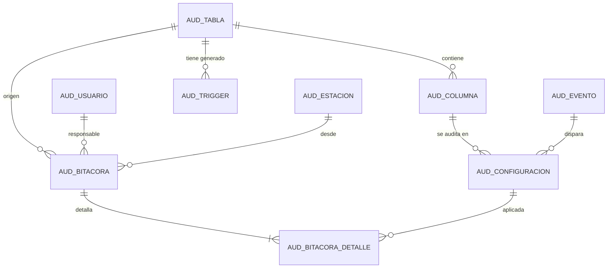

# AutoAudit — Guía de construcción del proyecto

> Proyecto del curso de Bases de Datos I (UMG) — Sistema de auditoría automatizado.
> Lenguaje principal: **Python**. Motor: **PostgreSQL 18**. SO de despliegue: **Ubuntu 26.04 LTS**.
> Esta guía es el plan maestro: cada criterio del enunciado tiene un componente que lo cumple y una prueba que lo demuestra (ver §9, Matriz de cumplimiento).

---

## 1. Arquitectura general

```
┌──────────────────────────────┐        ┌────────────────────────────────────────────┐
│  App web Python (FastAPI)    │        │  PostgreSQL 18                             │
│  ─ Login (rol admin/lector)  │  SQL   │  esquema "autoaudit"                       │
│  ─ Configuración de tablas,  │ ─────▶ │   ─ tablas de configuración                │
│    columnas y eventos        │ psycopg│   ─ bitácora centralizada (inmutable)      │
│  ─ Vista previa + generar    │        │   ─ generador de triggers en PL/pgSQL      │
│    triggers                  │ ◀───── │   ─ event trigger DDL (dependencias)       │
│  ─ Consultas / línea de      │        │   ─ funciones de consulta parametrizadas   │
│    tiempo / exportación      │        │  esquema(s) de negocio (ej. "demo")        │
│  CLI (Typer) para scripts    │        │   ─ tablas auditadas + triggers AFTER      │
└──────────────────────────────┘        └────────────────────────────────────────────┘
```

**División de responsabilidades (clave para la nota):**

| Capa | Qué hace | Por qué ahí |
|---|---|---|
| PL/pgSQL (en la BD) | Lee el diccionario de datos, valida, **genera y ejecuta** el `CREATE FUNCTION` + `CREATE TRIGGER` dinámico, escribe la bitácora | El enunciado exige "PL/SQL para la generación de triggers" (en PostgreSQL es PL/pgSQL) |
| Python (servidor) | Interfaz web, autenticación, orquesta llamadas al generador, consultas, reportes, exportación, pruebas | "Programación de servidor e interfaces, según decisión de la clase" → Python |

---

## 2. Stack tecnológico

| Componente | Elección | Uso |
|---|---|---|
| Python | 3.13 | Lenguaje principal |
| Web | **FastAPI** + Jinja2 + Bootstrap 5 + HTMX | Interfaz de configuración y consulta |
| Driver BD | **psycopg 3** (consultas 100 % parametrizadas) | Acceso a PostgreSQL |
| CLI | Typer | `autoaudit tablas`, `autoaudit generar`, `autoaudit reporte …` |
| Reportes | CSV (stdlib), Excel (openpyxl), PDF (reportlab), JSON | "Exportación en formatos estándar" |
| Gráficas | Chart.js (web) / matplotlib (informe de rendimiento) | Línea de tiempo y pruebas de carga |
| Pruebas | pytest + pytest-benchmark | Pruebas funcionales y de rendimiento |
| Despliegue | Script `install.sh` para Ubuntu 26.04 + `docker-compose.yml` | Instalación reproducible |
| CI (extra) | GitHub Actions con servicio `postgres:18` | Las pruebas corren solas en cada push |
| Docs | Markdown → PDF (pandoc / HTML a PDF) + Mermaid para el ER | Documento técnico entregable |

---

## 3. Modelo entidad‑relación (esquema `autoaudit`)

Cubre las 5 entidades obligatorias y las 2 relaciones exigidas.



| Tabla | Entidad del enunciado | Campos principales |
|---|---|---|
| `aud_tabla` | **Tablas auditadas** | id, esquema, nombre, oid, activa, fecha_alta, alta_por |
| `aud_columna` | **Columnas auditadas** | id, tabla_id → aud_tabla, nombre, tipo_dato, attnum, activa |
| `aud_evento` | **Eventos** (catálogo) | id, codigo (`I`,`U`,`D`), nombre (INSERT/UPDATE/DELETE) |
| `aud_configuracion` | **Eventos a auditar por columna y tabla** | id, columna_id, evento_id, activa, version, UNIQUE(columna_id, evento_id) |
| `aud_usuario` | **Usuarios auditados** | id, usuario_bd, usuario_app, auditar (bool), primera_vez |
| `aud_estacion` | **Estaciones de trabajo auditadas** | id, ip (inet, enmascarada/hash), hostname, application_name, auditar (bool) |
| `aud_bitacora` | Cabecera de cada operación | id, tabla_id, operacion, usuario_id, estacion_id, txid, fecha_hora (timestamptz), pk_registro (jsonb), fila_anterior (jsonb), fila_nueva (jsonb) |
| `aud_bitacora_detalle` | Cambio por columna | id, bitacora_id, **configuracion_id**, valor_anterior, valor_nuevo |
| `aud_trigger` | Gestión de dependencias | id, tabla_id, nombre_trigger, nombre_funcion, ddl_generado, hash, estado, fecha |
| `aud_error` | Manejo de errores | id, fecha, contexto, sqlstate, mensaje, detalle |
| `aud_parametro` | Política de privacidad, etc. | clave, valor (ej. `modo_ip = completa | enmascarada | hash`) |
| `aud_cambio_config` (extra) | Historial de quién cambió la configuración | id, fecha, admin, accion, antes, despues |

**Relaciones exigidas:**
1. *"La configuración referencia a los eventos que se deben registrar ante el cambio de una columna de una tabla"* → `aud_configuracion(columna_id → aud_columna → aud_tabla, evento_id → aud_evento)`.
2. *"Cada registro de bitácora referencia a una configuración específica usada, el usuario responsable y la estación de trabajo"* → `aud_bitacora_detalle.configuracion_id`, `aud_bitacora.usuario_id`, `aud_bitacora.estacion_id`.

**Normalización:** cabecera/detalle (3FN). La consulta "por columna" va directo a `aud_bitacora_detalle` con índice; "por usuario" a `aud_bitacora(usuario_id, fecha_hora)`.

**Preservar datos aunque se borre el origen:** la bitácora **no** tiene FK hacia las filas de negocio; guarda la fila completa en `fila_anterior` (jsonb) y los valores por columna en el detalle. Las FKs de la bitácora apuntan solo a la configuración (integridad referencial con las tablas configuradas). Las tablas/columnas configuradas nunca se borran físicamente: se **desactivan** (`activa = false`), así la bitácora histórica nunca queda huérfana.

---

## 4. Módulos y cómo se implementan

### 4.1 Configuración de auditoría
- **Consultas al diccionario de datos** (`sql/02_diccionario.sql`): funciones `autoaudit.fn_listar_tablas()` y `autoaudit.fn_listar_columnas(esquema, tabla)` sobre `pg_catalog` (`pg_class`, `pg_attribute`, `pg_namespace`, `pg_constraint` para la PK) e `information_schema`.
- **Interfaz**: lista de tablas → al elegir una, checklist de columnas × checkboxes INSERT/UPDATE/DELETE.
- **Validación previa** (`fn_validar_config`): verifica con `to_regclass()` y `pg_attribute` que la tabla y cada columna existan, que la tabla tenga PK (si no, se usa `ctid` y se advierte), y que no sea una tabla del propio esquema `autoaudit`.
- **Persistencia**: procedimiento `autoaudit.sp_configurar(tabla, columnas[], eventos[])` que hace upsert en `aud_tabla/aud_columna/aud_configuracion` y registra el cambio en `aud_cambio_config`.

### 4.2 Generación de triggers (PL/pgSQL)
`autoaudit.sp_generar_trigger(p_tabla_id)`:
1. Lee la configuración activa de esa tabla.
2. Construye con `format('%I.%I', …)` (evita inyección SQL) una **función por tabla** `autoaudit.trg_fn_<esquema>_<tabla>()` y **un trigger por tabla** (cumple "cada trigger maneja exclusivamente una tabla origen"):
   ```sql
   CREATE TRIGGER aa_demo_clientes
   AFTER INSERT OR UPDATE OF nombre, correo OR DELETE ON demo.clientes
   FOR EACH ROW EXECUTE FUNCTION autoaudit.trg_fn_demo_clientes();
   ```
   - **AFTER** y `FOR EACH ROW` → captura valores completos (`OLD` / `NEW`).
   - Solo incluye las operaciones habilitadas; `UPDATE OF <columnas>` y comparación `IS DISTINCT FROM` para que solo se registre lo que realmente cambió (rendimiento).
   - Código de columnas "desenrollado" en el cuerpo de la función (sin bucles genéricos con jsonb en cada fila) → más rápido.
3. Guarda el DDL generado + hash en `aud_trigger`; si ya existía, hace `DROP … IF EXISTS` y recrea (idempotente).
4. Si no queda ninguna columna/evento activo → elimina el trigger (refleja el estado actual).
5. Todo dentro de `BEGIN … EXCEPTION WHEN OTHERS` → guarda en `aud_error` y devuelve mensaje claro a Python.
- **Vista previa (dry‑run)**: `fn_previsualizar_trigger(p_tabla_id)` devuelve el SQL sin ejecutarlo; la interfaz lo muestra antes de aplicar.
- **Gestión de dependencias**: *event trigger* `autoaudit_ddl_guard` sobre `sql_drop` y `ddl_command_end`:
  - Si se borra una tabla auditada → la marca inactiva y limpia `aud_trigger`.
  - Si se borra/renombra una columna auditada → desactiva la configuración y regenera el trigger.
  - Vista `v_estado_triggers` que compara `aud_trigger` vs `pg_trigger` real (detecta desincronización).

### 4.3 Almacenamiento de bitácora
- La función de trigger obtiene contexto: `current_user`/`session_user`, `current_setting('autoaudit.usuario_app', true)` (usuario real de la app web), `inet_client_addr()`, `application_name`, `txid_current()`, `clock_timestamp()`.
- Inserta 1 fila en `aud_bitacora` + N en `aud_bitacora_detalle` (una por columna configurada que cambió).
- `aud_bitacora` con índices en `(usuario_id, fecha_hora)`, `(tabla_id, fecha_hora)`, GIN en la llave del registro, y detalle `(configuracion_id, bitacora_id)`. (Se probó particionarla por mes, pero la llave foránea detalle→cabecera particionada triplicaba el costo de cada trigger, así que se descartó: ver pruebas de rendimiento.)
- **Privacidad de IP**: según `aud_parametro.modo_ip` se guarda completa, enmascarada (`192.168.1.0/24`) o como hash SHA‑256 con sal.

### 4.4 Consulta y reporte
Funciones SQL parametrizadas (`sql/06_consultas.sql`), llamadas desde Python con parámetros (nunca concatenando):
- `fn_cambios_por_usuario(p_usuario, p_desde, p_hasta)`
- `fn_cambios_por_columna(p_esquema, p_tabla, p_columna, p_desde, p_hasta)`
- `fn_linea_tiempo(p_tabla, p_pk)` — historia cronológica de un registro.
- `fn_estado_en_fecha(p_tabla, p_pk, p_fecha)` (extra "viaje en el tiempo": reconstruye cómo era el registro en una fecha).
- Interfaz: filtros, tabla paginada, línea de tiempo visual, gráfica de actividad, botones **CSV / Excel / PDF / JSON**.

---

## 5. Seguridad

| Requisito | Implementación |
|---|---|
| Solo administradores configuran | Roles `autoaudit_admin` y `autoaudit_lector`. Los procedimientos de configuración/generación verifican `pg_has_role(session_user,'autoaudit_admin','MEMBER')` y además solo se otorga `EXECUTE` a ese rol. La web también exige login con rol admin. |
| Bitácora sin escritura directa | Dueño de las tablas: `autoaudit_owner` (NOLOGIN). `REVOKE INSERT, UPDATE, DELETE, TRUNCATE ON aud_bitacora* FROM PUBLIC`. Las funciones de trigger son `SECURITY DEFINER` con `SET search_path` fijo → son el único camino para escribir. Además un trigger `BEFORE UPDATE OR DELETE` en la bitácora que rechaza modificaciones (inmutable). |
| Privacidad de IP | Parámetro `modo_ip` (completa / enmascarada / hash) y lectura de la IP solo para `autoaudit_admin` mediante una vista; el lector ve la IP enmascarada. |
| Inyección SQL | `format(%I, %L)` en PL/pgSQL y parámetros en psycopg. |
| Credenciales | `.env` (no se sube a git), `.env.example` en el repo. |

---

## 6. Estructura del repositorio (GitHub)

```
autoaudit/
├── README.md                      # resumen, instalación rápida, capturas
├── docs/
│   ├── AutoAudit_Documentacion.pdf  # ENTREGABLE PDF
│   ├── er_diagrama.png / .mmd
│   ├── diccionario_datos.md       # generado automáticamente desde el catálogo
│   ├── manual_configuracion.md
│   └── instalacion_despliegue.md
├── sql/
│   ├── 00_roles.sql
│   ├── 01_esquema_tablas.sql      # scripts de creación de estructura
│   ├── 02_diccionario.sql         # consultas al diccionario de datos del DBMS
│   ├── 03_configuracion.sql       # validación + persistencia
│   ├── 04_generador_triggers.sql  # generación dinámica PL/pgSQL
│   ├── 05_event_triggers.sql      # dependencias DDL
│   ├── 06_consultas.sql           # consultas parametrizadas
│   ├── 07_seguridad.sql           # grants/revokes
│   └── 90_demo_datos.sql          # esquema demo (clientes, productos, ventas)
├── app/                           # Python
│   ├── main.py  (FastAPI)  ├── db.py  ├── auth.py
│   ├── routers/ (config, triggers, consultas, reportes)
│   ├── services/ (exportar.py, reportes.py)
│   ├── templates/  └── static/
├── cli/autoaudit_cli.py           # Typer
├── tests/
│   ├── test_insert.py  test_update.py  test_delete.py
│   ├── test_config_validacion.py  test_seguridad.py  test_errores.py
│   ├── test_dependencias_ddl.py   test_consultas.py
│   └── perf/test_rendimiento.py   # volumen creciente + gráfica
├── ejemplos/                      # ejemplos de uso paso a paso
├── scripts/install.sh  ├── docker-compose.yml  ├── Dockerfile
├── .github/workflows/ci.yml
├── requirements.txt  ├── .env.example  └── LICENSE
```

---

## 7. Pruebas de validación

| Prueba | Qué verifica |
|---|---|
| `test_insert` | INSERT genera 1 cabecera + detalle con `valor_anterior = NULL`, `valor_nuevo` correcto, usuario, estación, fecha |
| `test_update` | Captura valor antiguo y nuevo; columnas no configuradas o no cambiadas **no** se registran |
| `test_delete` | Tras borrar la fila origen, la bitácora conserva la fila completa (`fila_anterior`) |
| `test_config_validacion` | Rechaza tabla/columna inexistente; desactivar un evento elimina esa operación del trigger |
| `test_seguridad` | Usuario no admin no puede configurar; nadie puede `INSERT/UPDATE/DELETE` directo en la bitácora |
| `test_errores` | Error en generación queda en `aud_error` y la app muestra mensaje claro, sin dejar triggers a medias |
| `test_dependencias_ddl` | DROP COLUMN / DROP TABLE actualiza configuración y triggers |
| `test_consultas` | Por usuario devuelve historial completo; por columna devuelve todos sus cambios |
| `perf/test_rendimiento` | 1 k / 10 k / 100 k / 500 k operaciones con y sin auditoría → tabla + gráfica de % de sobrecosto (se incluye en el PDF) |

---

## 8. Documento PDF entregable (contenido)

1. Portada e índice
2. Descripción y objetivos
3. Arquitectura
4. **Diagrama entidad‑relación completo**
5. **Diccionario de datos** (cada tabla: columna, tipo, nulo, default, PK/FK, descripción — generado desde `pg_catalog` + `COMMENT ON`)
6. **Manual de configuración y activación de auditoría por tabla** (con capturas de la interfaz y equivalente en CLI)
7. **Procedimiento de instalación y despliegue de triggers** (Ubuntu 26.04 + PostgreSQL 18 paso a paso, y Docker)
8. Seguridad y privacidad
9. Resultados de pruebas funcionales y de rendimiento (gráficas)
10. Matriz de cumplimiento (§9 de esta guía)

---

## 9. Matriz de cumplimiento (todo criterio → evidencia)

| # | Criterio del enunciado | Cómo se cumple | Evidencia |
|---|---|---|---|
| O1 | Modelo ER completo | §3 | PDF cap. 4 |
| O2 | Configuración basada en diccionario de datos | `02_diccionario.sql`, UI | `test_config_validacion` |
| O3 | Generación automática de triggers I/U/D | `04_generador_triggers.sql` | `test_insert/update/delete` |
| O4 | Bitácora con información completa | `aud_bitacora` + detalle | `test_insert` |
| O5 | Consulta por usuario o columna | `06_consultas.sql`, UI | `test_consultas` |
| C1 | Seleccionar tablas existentes (diccionario) | `fn_listar_tablas` | UI + test |
| C2 | Selección granular de columnas | `aud_columna` | UI + test |
| C3 | Activar/desactivar por operación | `aud_configuracion.activa` por evento | `test_config_validacion` |
| C4 | Persistencia en tablas especializadas | esquema `autoaudit` | diccionario |
| G1 | Procesamiento automático de configuración | `sp_generar_trigger` | test |
| G2 | Generación de código SQL de triggers | DDL en `aud_trigger` + vista previa | UI |
| G3 | Triggers AFTER, valores completos | `AFTER … FOR EACH ROW`, `fila_anterior/nueva` | `test_delete` |
| G4 | Gestión de dependencias trigger‑tabla | `aud_trigger`, event triggers, `v_estado_triggers` | `test_dependencias_ddl` |
| B1 | Tabla centralizada | `aud_bitacora` | — |
| B2 | Estructura normalizada / optimizada | cabecera‑detalle e índices | perf |
| B3 | Valores antiguos y nuevos | `valor_anterior/valor_nuevo` | `test_update` |
| B4 | Usuario, fecha, hora, IP | `aud_usuario`, `aud_estacion`, `fecha_hora` | `test_insert` |
| R1 | Búsqueda por usuario | `fn_cambios_por_usuario` | `test_consultas` |
| R2 | Filtro por columna | `fn_cambios_por_columna` | `test_consultas` |
| R3 | Visualización cronológica | línea de tiempo | UI |
| R4 | Exportación estándar | CSV/XLSX/PDF/JSON | test exportación |
| E1‑E5 | Entidades: tablas, columnas, eventos, usuarios, estaciones | §3 | ER |
| RE1 | Config. referencia eventos por columna/tabla | `aud_configuracion` | ER |
| RE2 | Bitácora referencia config., usuario, estación | FKs | ER |
| T1 | PostgreSQL 18 | — | `SELECT version()` en PDF |
| T2 | Ubuntu 26.04 LTS | `install.sh` probado | captura en PDF |
| T3 | PL/pgSQL para triggers | `04_*.sql` | — |
| L1 | Un trigger por tabla origen | 1 función + 1 trigger por tabla | `v_estado_triggers` |
| L2 | Validar existencia antes de activar | `fn_validar_config` | test |
| L3 | Preservar datos aunque se borre el origen | jsonb + sin FK al origen | `test_delete` |
| S1 | Solo admin configura | roles + chequeo | `test_seguridad` |
| S2 | Bitácora sin escritura directa | REVOKE + SECURITY DEFINER + trigger inmutable | `test_seguridad` |
| S3 | Privacidad IP | `modo_ip` | test |
| AF1 | Triggers válidos para cada operación | — | tests I/U/D |
| AF2 | Todos los campos requeridos | NOT NULL + test | `test_insert` |
| AF3 | Consulta usuario = historial completo | — | `test_consultas` |
| AF4 | Consulta columna = todos los cambios | — | `test_consultas` |
| AT1 | Sin impacto significativo de rendimiento | triggers específicos, `UPDATE OF`, índices | `perf` + gráfica |
| AT2 | Config. refleja estado actual | `v_estado_triggers` | test |
| AT3 | Integridad referencial con tablas configuradas | FKs + borrado lógico | ER |
| AT4 | Manejo de errores | `EXCEPTION`, `aud_error`, mensajes en UI | `test_errores` |
| D1‑D4 | PDF: ER, diccionario, manual config., instalación | §8 | `docs/` |
| F1‑F5 | Repo: consultas diccionario, scripts, generador, consultas parametrizadas, ejemplos y pruebas | §6 | GitHub |
| P1‑P4 | Pruebas insert, update, delete, rendimiento | §7 | `tests/` |

---

## 10. Extras propuestos para sumar puntos

1. **Vista previa del SQL** antes de aplicar e **historial/versionado** de triggers generados.
2. **Event triggers DDL**: si alguien borra o renombra una tabla/columna auditada, el sistema se ajusta solo.
3. **"Viaje en el tiempo"**: reconstruir cómo estaba un registro en cualquier fecha y restaurar un valor anterior.
4. **Dashboard**: actividad por día, top usuarios, top tablas modificadas.
5. **Bitácora inmutable** con consultas por índice que se mantienen rápidas con millones de registros.
6. **Usuario real de la app** en la bitácora (no solo el usuario de conexión), vía `SET LOCAL autoaudit.usuario_app`.
7. **CLI** además de la web, para automatizar.
8. **CI en GitHub Actions** con PostgreSQL 18: badge "tests passing" en el README.
9. **Docker Compose**: el profesor levanta todo con un comando.
10. **Diccionario de datos autogenerado** desde el propio catálogo (el sistema se documenta solo).

---

## 11. Plan de trabajo

| Fase | Tareas |
|---|---|
| 0. Entorno | Instalar Python 3.13, PostgreSQL 18 (y Ubuntu 26.04 en WSL/VM para la evidencia), crear repo GitHub |
| 1. BD | Roles, esquema, tablas, diccionario, configuración, generador, event triggers, consultas, seguridad, datos demo |
| 2. Python | Conexión, login, pantallas de configuración, generación, consulta, exportación, dashboard, CLI |
| 3. Pruebas | Funcionales + rendimiento + CI |
| 4. Docs | ER, diccionario, manuales, PDF final, README con capturas |
| 5. Entrega | Push a GitHub, PDF, demo |


