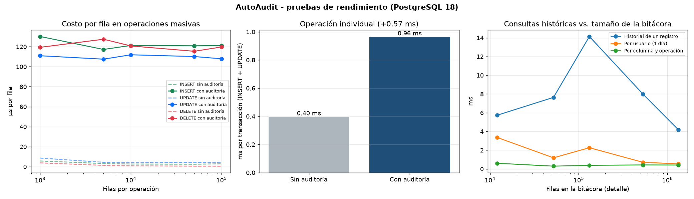

# Resultados de rendimiento

PostgreSQL 18.6 (Ubuntu 18.6-0ubuntu0.26.04.1). Tabla con 5 columnas; se auditan 3 columnas en INSERT, UPDATE y DELETE.

## Operaciones masivas (una sentencia sobre N filas)

Columnas: sin auditoría / con auditoría / con auditoría pero usuario de carga masiva excluido.

| Filas | INSERT (ms) | UPDATE (ms) | DELETE (ms) | µs extra por fila (INSERT) | Filas en bitácora (detalle) |
|---:|---:|---:|---:|---:|---:|
| 1,000 | 5.7 / 130.2 / 10.8 | 8.6 / 111.0 / 12.3 | 3.8 / 119.4 / 9.0 | 124.5 | 12,000 |
| 5,000 | 15.8 / 586.3 / 36.9 | 21.9 / 537.7 / 46.2 | 6.5 / 637.4 / 28.2 | 114.1 | 52,000 |
| 10,000 | 26.5 / 1212.5 / 73.2 | 41.2 / 1119.2 / 85.8 | 8.3 / 1207.7 / 53.5 | 118.6 | 132,000 |
| 50,000 | 123.4 / 6045.4 / 363.0 | 221.4 / 5508.6 / 461.0 | 25.9 / 5771.0 / 253.3 | 118.4 | 532,000 |
| 100,000 | 283.8 / 12113.4 / 703.0 | 408.1 / 10791.3 / 844.6 | 52.1 / 11972.4 / 512.4 | 118.3 | 1,332,000 |

## Operación individual (caso típico de una aplicación)

Promedio de 2000 transacciones de INSERT + UPDATE de una fila:

- Sin auditoría: **0.397 ms**
- Con auditoría: **0.965 ms** (+0.568 ms por transacción)

## Consultas históricas a medida que crece la bitácora (mediana, ms)

| Filas en bitácora | Historial de un registro | Por usuario (1 día) | Por columna y operación |
|---:|---:|---:|---:|
| 12,000 | 5.73 | 3.37 | 0.61 |
| 52,000 | 7.64 | 1.19 | 0.3 |
| 132,000 | 14.14 | 2.27 | 0.39 |
| 532,000 | 7.98 | 0.71 | 0.43 |
| 1,332,000 | 4.18 | 0.55 | 0.42 |

